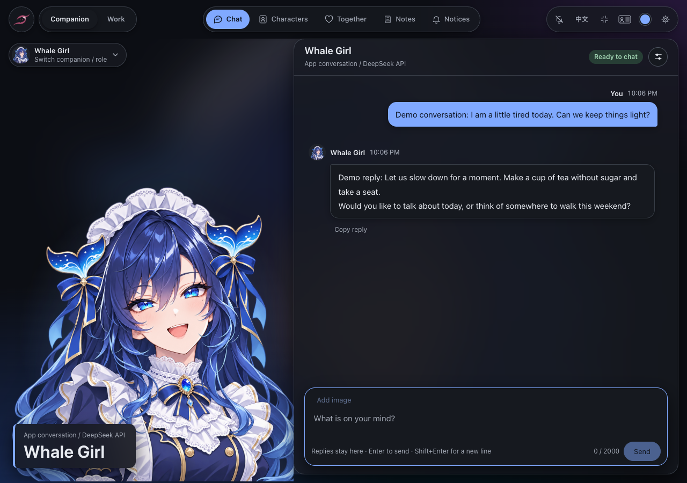
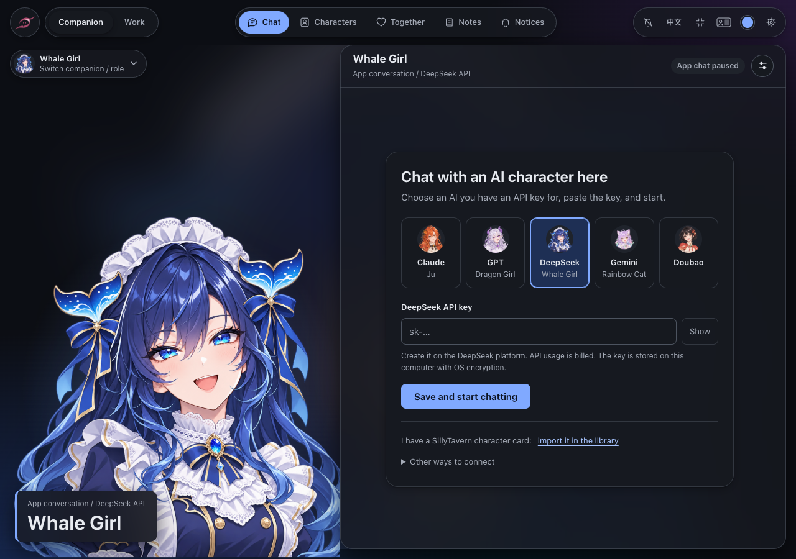

<p align="center"></p>

# Agent Arcade

**AI companions on your desktop, with conversations and memory you can keep.**

Bring an API key, choose a character and start a text conversation in one app. Agent Arcade keeps history and memory on your computer; messages go to the AI provider you choose. The app is fully open source under AGPL-3.0, with no paid features. Provider API usage is billed separately.

[简体中文](README.zh-CN.md) · [First-run guide](docs/FIRST_RUN.md) · [Build status](https://github.com/Ray0766/agent-arcade/actions) · [Validation](docs/VALIDATION.md)



*Current preview.8 renderer with independent demonstration data. These are not private chats or real-model response evidence. [Image sources and reproduction](docs/README_MEDIA.md).*

## What you can do

- **Talk in the app.** Use Claude, GPT, DeepSeek, Gemini or Doubao through its API. Chatting does not require QQ, WeChat, a project folder or observer hooks. Companion conversations have no file or shell tools.
- **Change your companion.** Switch the built-in persona while keeping the selected AI provider and key. Each persona has its own App history and memory; a separate saved profile also has separate credentials.
- **Keep memory under your control.** Read, add, correct and forget App facts. Changes apply to the selected companion's memory. [Conversation and memory details](docs/DESKTOP_CHAT.md).
- **Bring a character card.** Import SillyTavern PNG/JSON cards, world info and presets; use supported message editing, regeneration, branches and library-character groups. Imported scripts and extensions never execute. [Feature-by-feature scope](docs/SILLYTAVERN_PARITY.md).
- **Add context when you want it.** Optional calendar, folder and feed notices start disabled. Shared notes and reflection only take effect after owner approval. [Companion features](docs/COMPANION.md).
- **Keep the Work side.** Follow Claude Code session events, inspect local results and use the existing worktree task board. A reply ending or a task being handed back does not mean it passed verification. [Task board](docs/TASK_BOARD.md).

Three layouts—immersive, messenger and minimal—share the same Companion and Work spaces. Choose day, night or Follow system, with an accent that follows the character or stays fixed.

## Start with one API key

For the development source below and a fresh profile:

1. Start the app and open **Companion → Chat / 陪伴 → 对话**.
2. Choose an AI provider and paste that service's API key.
3. Choose **Save and start chatting / 保存并开始聊天**, then send a message.



*The current first-run screen, rendered with an empty demonstration profile. No real key, login or model request is used.*

Consumer subscriptions are separate from API credit. Default App chat calls the chosen provider directly; it does not require an Agent Arcade server. Optional relay and remote-management routes have separate deployment requirements. The [shared first-run guide](docs/FIRST_RUN.md) covers both languages and recovery boundaries.

Already have a card? Open **Characters**, import a PNG/JSON card, then choose **Chat as this character**. Voice and social channels are optional, separate setup paths.

## Read and change what your companion remembers

Open **Together → Memory / 相处 → 记得的事** to review the selected persona's App facts. If a channel source is also offered, choose **App memory / App 记忆**. You can add a fact, correct it or forget it without setting up a social account. App memory and channel memory are separate; check the selected source before changing a record. Correcting or forgetting also clears that persona's recent App conversation and freeform notes so the old fact is not supplied again; other personas and QQ records are kept.


*Demonstration facts in the production renderer. This image illustrates the controls; it does not establish model recall quality.*

The local preview.8 passed bounded real DeepSeek checks for manual-memory recall after restart, two-persona isolation and forgetting. Those tests also found and repaired a stale hidden reply announcement. [Exact flow, build identity and limits](docs/REAL_MEMORY_FLOW_20261116.md).

## Which version can I use?

Availability checked read-only on **2026-11-19**:

| Version | How to obtain it | Boundary |
| --- | --- | --- |
| **Current development source · 0.4.0-preview.8** | `main` and `codex/github-update-20261119`; use the exact source commands below for the documented checkpoint. | Includes the integrated Mac, credential, chat and memory repairs. It is not a released installer. |
| **Local personal-use Mac candidate · 0.4.0-preview.8** | Installed on the maintainer's Apple Silicon Mac; build source `8dd258c401554b51d89a8e6923586e8095783515`. | Self-signed, unnotarized and unpublished. [Package hashes and evidence](docs/REAL_MEMORY_FLOW_20261116.md). |
| **Published Windows preview · 0.3.0-preview.2** | [Executable, checksum and lockfile](https://github.com/Ray0766/agent-arcade/releases/tag/v0.3.0-preview.2). | Older MIT-licensed WeChat task/observer app. Use [its own instructions](docs/releases/0.3.0-preview.2.md); it does not contain the App-first key card above. |

**There is no public Mac candidate download.** Local packages and Actions artifacts are not release assets. See [macOS setup and limitations](docs/MACOS.md) and [candidate history](docs/CANDIDATE_STATUS.md). Updating GitHub source does not publish an installer.

## Run from source

Use Git and [Node.js 24.18+ within 24.x](https://nodejs.org/) for the documented development/test route. The package minimum is 22.13; that is not the full-suite requirement. Use a **new directory** and leave existing modified checkouts intact.

```sh
git clone --branch codex/github-update-20261119 --single-branch https://github.com/Ray0766/agent-arcade.git agent-arcade-companion
cd agent-arcade-companion
git checkout --detach e0decedf41cac1b8217fd51b5711b925c45b0b60
git rev-parse HEAD
npm ci
npm start
```

Expected HEAD: `e0decedf41cac1b8217fd51b5711b925c45b0b60`. This [source checkpoint](https://github.com/Ray0766/agent-arcade/tree/e0decedf41cac1b8217fd51b5711b925c45b0b60) contains preview.8 runtime code and its later verification documentation; the installed package's build-source commit is recorded separately above. Neither a version string nor a successful build means a release was published.

- `npm start` runs `electron .`. Close an existing app before starting this single-instance app.
- `npm run demo` supplies labelled observer examples under **Work → Sessions**. It does not simulate an AI conversation. It uses the same default data folder as normal startup, so it is **not an isolated trial profile**.
- `npm ci` does not download voice models. [Optional voice setup](docs/VOICE_LOCAL_SETUP.md) remains separate.
- Mac builds use the project entries documented in [MACOS](docs/MACOS.md); no publication is performed by the standard packaging commands.

## Your data and updates

The default folder is `~/.agent-arcade/` (`C:\Users\<name>\.agent-arcade\` on Windows). `AGENT_ARCADE_HOME` selects another location. It contains settings, conversations and memory in SQLite, characters, notes and encrypted credentials. **Deleting it removes those records.**

API keys and chat tokens use OS encryption; conversation databases and observer JSON are not encrypted. A model request transmits conversation context to the selected provider. Optional channels have their own data flows and permission boundaries. [Security and privacy](SECURITY.md).

Retain a backup before changing builds. The source includes automatic update backups and credential recovery; the local Mac uses a fixed credential component with one initial OS grant. The maintainer's signing credentials and installed authorization are not distributed. Another Mac or arbitrary signer is not accepted by the local checks. [Backups](docs/UPDATE_BACKUPS.md) · [Credential retention](docs/CREDENTIAL_RETENTION.md).

## Optional paths already in the project

| Path | Setup and limits |
| --- | --- |
| WeChat, QQ, Feishu, Messenger and X | [Channel/backend matrix](docs/CHANNELS_AND_AI.md) · [WeChat ClawBot](docs/WECHAT.md) · [QQ setup](docs/QQ_INTEGRATION.md). Ordinary personal WeChat and Moments are not implemented. QQ requires an existing user-supplied unofficial bridge; fresh component download is unavailable and expansion stays frozen. |
| Local Claude and coding tools | [Claude program mode](docs/CLAUDE_PROGRAM.md) · [Codex](docs/CODEX.md) · [Architecture](docs/ARCHITECTURE.md). Original CLI sign-in and permissions stay separate from API keys. Local Codex remains coding-only until tools can be verifiably disabled. |
| Observer, local results and task board | [Technology and evidence](docs/TECHNOLOGY_IMPLEMENTATION.md) · [Task board](docs/TASK_BOARD.md). Hooks are opt-in; an absence of new events is not evidence of completion. |
| Voice and appearance | [Voice setup](docs/VOICE_LOCAL_SETUP.md) · [Appearance](docs/APPEARANCE.md) · [Theme format](docs/THEMES.md). Voice models are not downloaded automatically. |

Existing features are retained; this round prioritizes Chinese desktop text companionship for people who already have an API key. 3D characters remain a later plan.

## What has actually been checked

The local Apple Silicon candidate has bounded real DeepSeek chat, switching, restart retention, manual memory and forgetting evidence. Versioned checks cover native Quit, update backups and the fixed credential client. Automated renderer/component checks cover additional features, using synthetic data and provider stand-ins where labelled.

**Still open:** first-stranger installation, another Mac or Intel, broader memory/reminder quality, Gemini/Doubao calls, notification and file-picker dialogs, real Chinese IME, sleep/wake, daily use and external-user adoption. Earlier Windows/QQ results retain their own version and route; they do not accept new App flows. [Validation ledger](docs/VALIDATION.md) · [Nine-feature acceptance](docs/COMPANION_ACCEPTANCE.md) · [Concentrated trial checklist](docs/ADOPTION_TRIAL_KIT.md).

`WORK_LOG.md`, raw receipts, private screenshots and local profile/build paths are not public evidence or download links.

## Develop and contribute

After `npm ci`, install the transfer helper's separately locked dependencies for its tests. This does not deploy or start a service.

```sh
npm ci --prefix deploy/transfer-helper --ignore-scripts --omit=optional --no-audit --no-fund
npm test
npm run check
npm run check:first-run
npm run check:release
npm run test:transfer-helper
npm run test:ui
npm run test:bot-ui
npm run test:bot-flow
npm run test:native
npm run dist
```

Dependencies and the resolved lockfile are committed. Read [CONTRIBUTING](CONTRIBUTING.md), [AGENTS](AGENTS.md), the [quality brief](docs/QUALITY_BRIEF.md) and [architecture](docs/ARCHITECTURE.md). Submit a reproducible problem, a small change and the checks that support it; keep credentials and private transcripts out of issues and commits.

## License and credits

Agent Arcade is **AGPL-3.0-only**, with no paid features ([LICENSE](LICENSE)). Versions published before 2026-11-13 retain their MIT license ([historical text](LICENSE-MIT-HISTORICAL)). SillyTavern adaptations are recorded in [the vendor source](src/vendor/sillytavern/README.md); dependencies retain their own licenses. The optional proprietary Claude Agent SDK is excluded from packages. [Third-party notices](THIRD_PARTY_NOTICES.md).

The [ribbon](src/assets/brand/README.md) and [character portraits](src/ui/portraits/README.md) were generated for this project; their provenance and license boundaries are recorded alongside the assets. Sprout Bot and pixel scenes are drawn by the project's asset scripts. This community project is not affiliated with Tencent, Anthropic or PeonPing.
