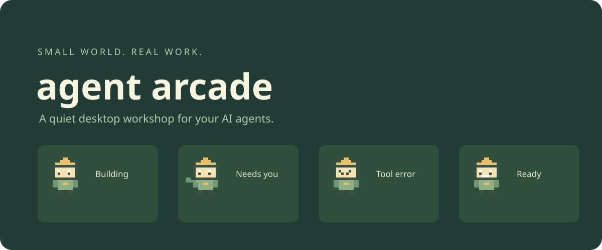

<p align="center"></p>

<p align="center"><a href="README.zh-CN.md">简体中文</a> · <a href="https://github.com/Ray0766/agent-arcade/actions">Build status</a> · <a href="https://github.com/Ray0766/agent-arcade/releases">Downloads</a> · <a href="docs/THEMES.md">Make a theme</a></p>

# Agent Arcade

**One little world. All your agents, at a glance.**

Agent Arcade is a local desktop companion for **Claude Code**. Each session and subagent gets a tiny workstation: building, asking for attention, recovering from a tool error, or delivering a response. It observes official lifecycle hooks; it does not infer completion from an animation or an idle timer.

**0.1.0 preview:** Windows first. Core event handling is tested with real hook subprocesses and synthetic payloads. CI verifies the Electron app and Windows package before publishing the first preview. A successful CI run is not a live Claude Code acceptance test; see [validation and limitations](docs/VALIDATION.md).

## Try it

Install [Node.js 22+](https://nodejs.org/) and a current [Claude Code](https://code.claude.com/docs/en/overview) version with the hooks listed below.

```sh
git clone https://github.com/Ray0766/agent-arcade.git
cd agent-arcade
npm install
npm run demo
```

For a dependency-free visual preview, open `src/ui/index.html` in a browser. It is explicitly a demo and cannot connect to live sessions.

For the real desktop workshop, run `npm start` (or a verified Windows portable download), open **Settings & themes → Install hooks**, then restart Claude Code and submit a prompt. Use several Claude Code sessions or launch subagents to populate more stations. **Go live** exits the isolated demo world.

The installer merges observer commands into `~/.claude/settings.json`, backs up existing settings, and copies the observer into `~/.agent-arcade/bin/`. Removing hooks leaves unrelated hooks intact. No terminal command is approved or executed by clicking a character; respond to approval prompts in Claude Code itself.

## What is here

- Separate stations for sessions and subagents, with names, event timestamps, and recent history.
- Original **Sprout Bot** pixel art, Moss Workshop and Lunar Post themes; state labels work without color or animation.
- Silent desktop notifications, opt-in; focus suppression, a per-agent cooldown, and quiet mode.
- A compact always-on-top window; close-to-tray when the platform supports a tray icon.
- Click a delivered parcel to inspect a final reply, if local result capture was enabled beforehand.
- English and Simplified Chinese, keyboard controls, and reduced-motion support.
- Declarative JSON themes with no JavaScript, remote images, or remote fonts.

## What a status actually means

| Observed event | Scene | Meaning |
| --- | --- | --- |
| `UserPromptSubmit`, `PreToolUse`, `PostToolUse`, `SubagentStart` | Building | Activity observed; not a progress percentage |
| `PermissionRequest`, `AskUserQuestion`, relevant `Notification` | Needs you | Return to Claude Code to respond |
| `PostToolUseFailure` | Error observed | A tool failed; the agent may recover on its next action |
| `StopFailure` | Error observed | A turn ended with an API failure |
| `Stop`, `SubagentStop` | Ready | Response ended, **not proof the requested work succeeded** |
| `Stop` with background work / scheduled wakeup | Building / Idle | Do not claim all work has finished |
| `SessionEnd` | Ended | Session closed; unfinished children become uncertain |
| No event for five minutes while active | Uncertain | The last state may be stale; never auto-completed |

Multiple pending tool permissions are tracked separately. Old events and duplicate delivery cannot replace newer state. Events are observed at hook time: another Stop hook can continue a turn, a long-running tool can become uncertain, and user interruptions do not always emit a terminal event. See [accuracy notes](docs/ARCHITECTURE.md).

## Local by design

No account, telemetry, web server, network listener, or cloud service. The observer stores a project **folder name**, session/agent IDs, event names, tool names/IDs and timestamps. It drops prompts, tool arguments, raw errors, and transcript paths. Final reply text is **off by default** and capped at 16,000 characters when enabled. Data is ordinary local JSON, not encrypted; do not enable result capture for replies you do not want stored on disk.

The inbox is bounded to roughly 2,000 files/24 hours while hooks run; the app retains at most 200 stations and 30 events per station. Turning off capture clears saved reply text. **Clear finished** removes delivered/ended stations. Quit and remove `~/.agent-arcade/` after uninstalling hooks to erase local app data. Hook backups remain beside Claude settings so you can restore them deliberately.

## Develop

```sh
npm test           # Node's built-in runner; no dependencies needed
npm run check      # JavaScript syntax checks
npm run test:ui    # isolated Electron + installed hook smoke test
npm run dist      # package for the current OS
```

Direct development dependencies are pinned. The verified build attaches the resolved `package-lock.json` to its artifact/release; copy it into the checkout and use `npm ci` to reproduce that dependency graph. macOS/Linux packaging is configured but is not included in the first Windows acceptance target.

Read [CONTRIBUTING.md](CONTRIBUTING.md), the [theme format](docs/THEMES.md), [architecture](docs/ARCHITECTURE.md), and [security policy](SECURITY.md). The first priority is reliable observation. Additional tools, clickable IDE navigation, richer themes, signed installers, and automatic updates are future work.

## Credits and license

Code, docs, and original pixel/vector artwork are **MIT licensed**. Sprout Bot and the workshop art are drawn in `scripts/create-assets.cjs`; no third-party game characters or sounds are used. Electron and development dependencies retain their own licenses. Agent Arcade is an independent community project, not affiliated with Anthropic or PeonPing.
