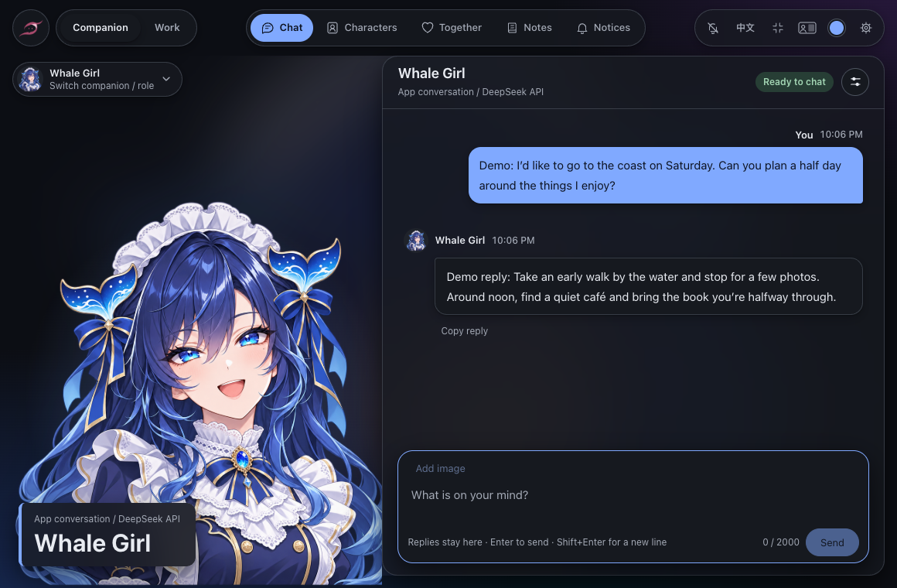
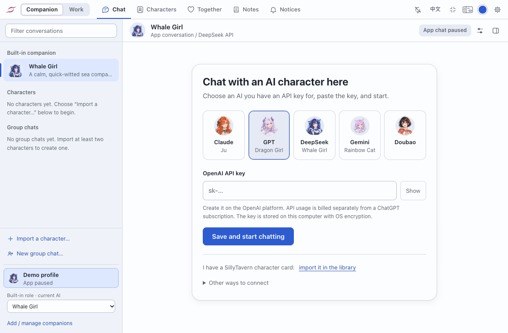
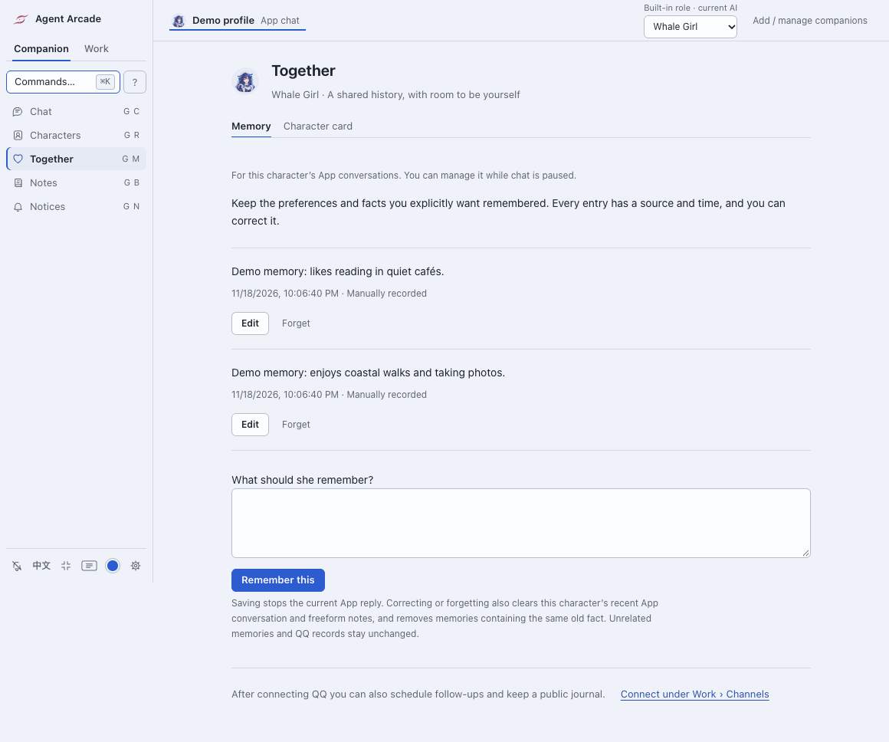
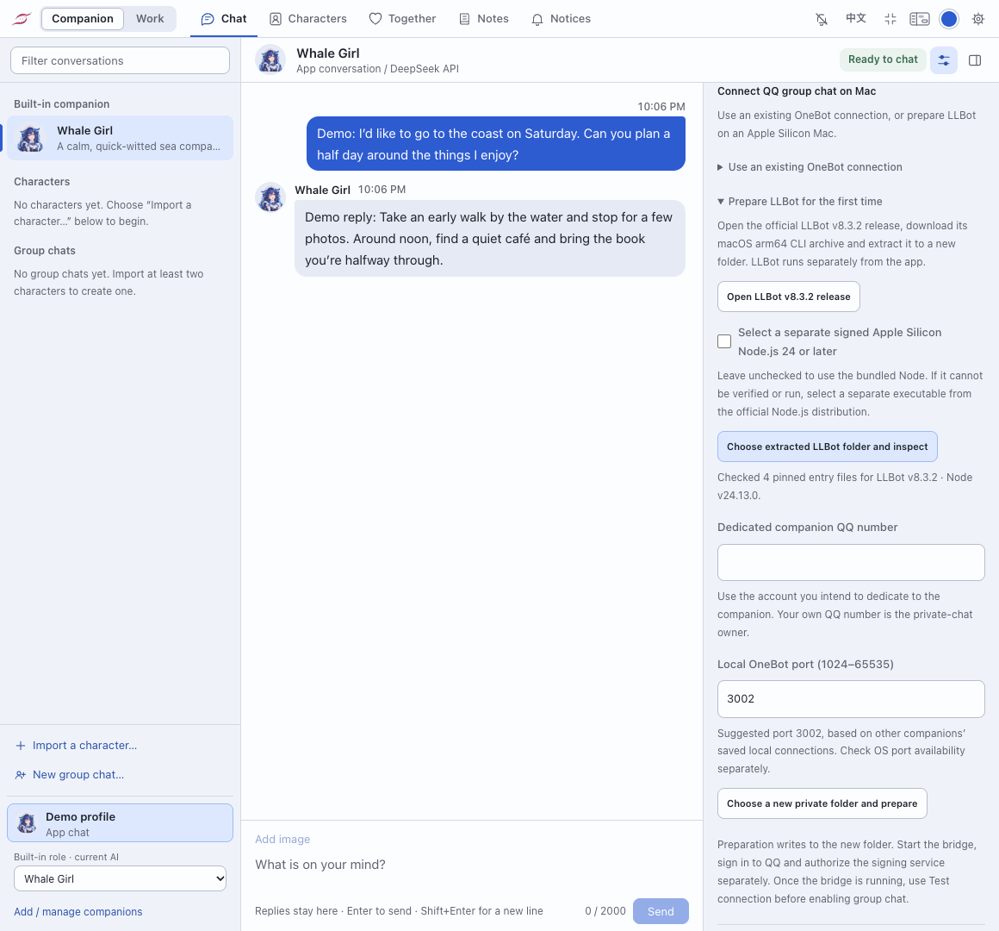

<p align="center"></p>

# Agent Arcade

**Chat with AI companions on your desktop.** Use your own API key to start a conversation, switch characters, and manage what each companion remembers. Chat history and memories are stored on your computer. Agent Arcade is open source under AGPL-3.0. API usage is billed by your model provider.

[简体中文](README.zh-CN.md) · [First-run guide](docs/FIRST_RUN.md) · [Validation](docs/VALIDATION.md)

Run the public **preview.8** source to try App chat. The **preview.61** screenshots below show a newer local Mac candidate. See [Run from source](#run-from-source) for both versions.

On Apple Silicon, build the [QQ group QA source](https://github.com/Ray0766/agent-arcade/tree/preview/mac-qq-qa.3) to exercise friendship checks and recovery from model failures in preview.61.qa.3. Each QA launch uses a fresh temporary profile.



*Companion → Chat in the local Apple Silicon verification build. Screenshots use synthetic chats, profiles, and memories. [Screenshot versions and sources](docs/README_MEDIA.md).*

## Start a conversation

1. Follow [Run from source](#run-from-source) and open **Companion → Chat**.
2. Select the provider for your API key: Claude, GPT, DeepSeek, Gemini, or Doubao.
3. Paste the key, click **Save and start chatting**, and send a message.



For App chat, you only need your provider’s API key. The app sends requests directly to that provider. Companion chat has no file or shell tools. [Provider and channel details](docs/CHANNELS_AND_AI.md).

## Change companions and manage memory

Use the companion switcher to change the character you chat with. The current provider and key stay selected, while each character has its own App conversation and memory. Save a separate profile when you want separate credentials. You can also import a SillyTavern PNG or JSON card in **Characters** and choose **Chat as this character**. [Character card support](docs/SILLYTAVERN_PARITY.md).


Go to **Together → Memory** to review, add, correct, or forget an App fact. If a channel memory source is available, choose **App memory** to see this companion’s local facts. Correcting or forgetting a fact also clears that character’s recent App conversation and freeform notes to stop old context from resurfacing. Other characters and QQ records are kept. [How App memory works](docs/DESKTOP_CHAT.md).



You can switch between immersive, messenger and minimal layouts, choose day, night or system appearance, and let the accent color follow your character. [Appearance](docs/APPEARANCE.md).

## Run from source

| Version | Where to start |
| --- | --- |
| **0.4.0-preview.8** development source | GitHub `main`. Use the exact checkpoint below for public App chat, the companion switcher, and App memory. |
| **0.4.0-preview.61** local Mac candidate | The build shown here was tested on Apple Silicon with an isolated profile. There is no public Mac installer. |
| **0.3.0-preview.2** Windows download | [Public Windows preview](https://github.com/Ray0766/agent-arcade/releases/tag/v0.3.0-preview.2) with the [WeChat task and observer workflow](docs/releases/0.3.0-preview.2.md). |

Install Git and [Node.js 24.18+ within 24.x](https://nodejs.org/). Run these commands in a new directory to open the public source checkpoint.

```sh
git clone --branch main --single-branch https://github.com/Ray0766/agent-arcade.git agent-arcade-companion
cd agent-arcade-companion
git checkout --detach e7b58508ffc79a108dc95f20685288ae3ca078d6
git rev-parse HEAD
npm ci
npm start
```

Expected HEAD is `e7b58508ffc79a108dc95f20685288ae3ca078d6`. Quit a running Agent Arcade instance before starting another. [First-run guide](docs/FIRST_RUN.md).

## Local data and updates

Agent Arcade uses `~/.agent-arcade/` by default. Set `AGENT_ARCADE_HOME` to choose a different location. Both `npm start` and `npm run demo` use the default folder unless you override it. The demo provides labeled Work observer events. Your API keys use OS encryption. Conversation databases remain readable locally, and each model request sends the conversation context to the provider you choose. [Privacy and security](SECURITY.md).

Keep a backup of the data directory before changing builds. The Mac credential component and its initial system grant are local to the Mac where they were set up. See the recovery instructions if an update cannot open a saved key. [Backups](docs/UPDATE_BACKUPS.md) · [Credential retention](docs/CREDENTIAL_RETENTION.md).

## Optional features

- **Work** shows Claude Code session events, local results, and the worktree task board. A task handed back still needs review. [Task board](docs/TASK_BOARD.md).
- **Reminders** can watch calendars, folders, and feeds after you enable the source. Shared notes and reflection proposals require owner approval. [Companion features](docs/COMPANION.md).
- **Channels and voice** have their own setup. The public source uses a separately supplied OneBot bridge for QQ. [Channels](docs/CHANNELS_AND_AI.md) · [Voice setup](docs/VOICE_LOCAL_SETUP.md).

### Latest local Mac preview

Under **Work → Channels → Set up QQ group chat**, you can connect an existing OneBot bridge or prepare a configuration for a separately installed LLBot. Use a group the companion has already joined, and make sure the owner and companion QQ accounts are friends. Group replies and proactive messages have separate settings. In the isolated preview.61 checks, companions handled mentions and quoted replies, and record corrections, reminder changes, and cancellations stayed scoped to the right character and sender. [Local candidate scope](docs/CANDIDATE_STATUS.md#local-apple-silicon-preview61).



## What has been verified

Preview.8 ran bounded real DeepSeek checks for first reply, companion switching, restart retention, manual memory recall, isolation, and forgetting. Preview.61 passed isolated Apple Silicon package checks with a QQ bridge and model stand-in. Preview.61 still needs live QQ login and group delivery, real model use, a first installation on another Mac, Intel testing, system dialogs, Chinese input methods, sleep and wake, and external user trials. [Real-model checks](docs/REAL_MEMORY_FLOW_20261116.md) · [Local candidate checks](docs/CANDIDATE_STATUS.md#local-apple-silicon-preview61) · [Trial checklist](docs/ADOPTION_TRIAL_KIT.md).

## Contribute

Run `npm test`, `npm run check`, `npm run check:first-run` and `npm run check:release` after installing the locked dependencies. [Contribution guide](CONTRIBUTING.md) · [Architecture](docs/ARCHITECTURE.md) · [Quality brief](docs/QUALITY_BRIEF.md).

Agent Arcade is [AGPL-3.0-only](LICENSE), with no paid features. Older MIT releases keep their [original license](LICENSE-MIT-HISTORICAL). [Third-party notices](THIRD_PARTY_NOTICES.md) · [SillyTavern adaptations](src/vendor/sillytavern/README.md) · [Artwork credits](docs/README_MEDIA.md).
