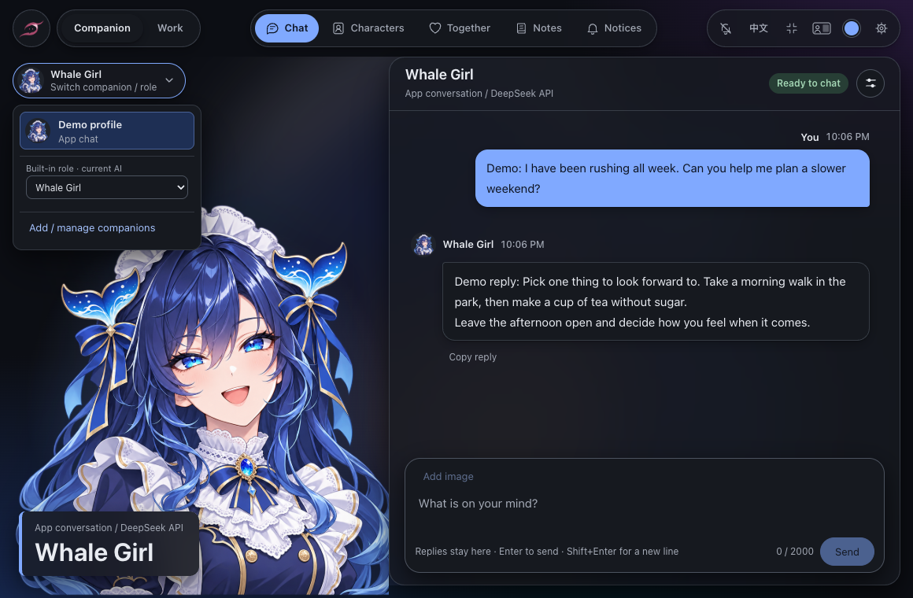

<p align="center"></p>

# Agent Arcade

**A desktop app for conversations with AI companions.** Bring an API key, choose a character, and start chatting. Your computer stores the conversation history and each companion’s memories. Agent Arcade is open source under AGPL-3.0. Model providers bill API usage separately.

[简体中文](README.zh-CN.md) · [First-run guide](docs/FIRST_RUN.md) · [Validation](docs/VALIDATION.md)


*Companion → Chat in the immersive layout. All screenshots use the preview.8 interface and synthetic demo data. [Screenshot sources](docs/README_MEDIA.md).*

## Start a conversation

1. Run the [development source](#run-from-source) and open **Companion → Chat**.
2. Choose Claude, GPT, DeepSeek, Gemini or Doubao, then paste that provider’s API key.
3. Click **Save and start chatting** and send your first message.


The app calls your chosen provider directly for this path. You can start without a social account, a project folder or a CLI login. Companion chat runs without file or shell tools. [Provider and channel details](docs/CHANNELS_AND_AI.md).

## Change companions and manage memory

Open the companion switcher to choose a different built-in character. The AI provider and key stay selected. Each character has its own App conversation and memory. Separate profiles also have separate credentials. You can also import a SillyTavern PNG or JSON card in **Characters** and choose **Chat as this character**. [Character card support](docs/SILLYTAVERN_PARITY.md).



Go to **Together → Memory** to review, add, correct, or forget an App fact. If a channel memory source is available, choose **App memory** to see this companion’s local facts. Correcting or forgetting a fact also clears that character’s recent App conversation and freeform notes to stop old context from resurfacing. Other characters and QQ records are kept. [How App memory works](docs/DESKTOP_CHAT.md).


You can switch between immersive, messenger and minimal layouts, choose day, night or system appearance, and let the accent color follow your character. [Appearance](docs/APPEARANCE.md).

## Run from source

GitHub `main` contains **0.4.0-preview.8 development source**. The public download is the older Windows [0.3.0-preview.2 preview](https://github.com/Ray0766/agent-arcade/releases/tag/v0.3.0-preview.2), which uses the [WeChat task and observer workflow](docs/releases/0.3.0-preview.2.md). **There is currently no public Mac installer.** [Candidate status](docs/CANDIDATE_STATUS.md) · [macOS setup](docs/MACOS.md).

Install Git and [Node.js 24.18+ within 24.x](https://nodejs.org/). In a new directory, use the source checkpoint for the interface shown above:

```sh
git clone --branch main --single-branch https://github.com/Ray0766/agent-arcade.git agent-arcade-companion
cd agent-arcade-companion
git checkout --detach e7b58508ffc79a108dc95f20685288ae3ca078d6
git rev-parse HEAD
npm ci
npm start
```

Expected HEAD is `e7b58508ffc79a108dc95f20685288ae3ca078d6`. Quit a running Agent Arcade instance before starting another. [First-run guide](docs/FIRST_RUN.md).

## Local data and updates

Agent Arcade uses `~/.agent-arcade/` by default. Set `AGENT_ARCADE_HOME` to choose a different location. Both `npm start` and `npm run demo` use the default folder unless you override it. The demo provides labeled Work observer events. Your API keys use OS encryption. Conversation databases remain readable locally, and each model request sends the conversation context to the provider you choose. [Privacy and security](SECURITY.md).

Keep a backup of the data directory before changing builds. The Mac credential component and its initial system grant are local to the Mac where they were set up. See the recovery instructions if an update cannot open a saved key. [Backups](docs/UPDATE_BACKUPS.md) · [Credential retention](docs/CREDENTIAL_RETENTION.md).

## Optional features

- **Work** shows Claude Code session events, local results, and the worktree task board. A task handed back still needs review. [Task board](docs/TASK_BOARD.md).
- **Reminders** can watch calendars, folders, and feeds after you enable the source. Shared notes and reflection proposals require owner approval. [Companion features](docs/COMPANION.md).
- **Channels and voice** are separate setup paths. The documented QQ route uses an existing bridge supplied by the user. [Channels](docs/CHANNELS_AND_AI.md) · [Voice setup](docs/VOICE_LOCAL_SETUP.md).

## What has been verified

An unpublished Apple Silicon preview.8 ran bounded real DeepSeek checks for first reply, companion switching, restart retention, manual memory recall, isolation and forgetting. First-time installation on another Mac, Intel, system dialogs, Chinese input methods, sleep/wake and external user trials remain pending. [Exact build and test scope](docs/REAL_MEMORY_FLOW_20261116.md) · [Trial checklist](docs/ADOPTION_TRIAL_KIT.md).

## Contribute

Run `npm test`, `npm run check`, `npm run check:first-run` and `npm run check:release` after installing the locked dependencies. [Contribution guide](CONTRIBUTING.md) · [Architecture](docs/ARCHITECTURE.md) · [Quality brief](docs/QUALITY_BRIEF.md).

Agent Arcade is [AGPL-3.0-only](LICENSE), with no paid features. Older MIT releases keep their [original license](LICENSE-MIT-HISTORICAL). [Third-party notices](THIRD_PARTY_NOTICES.md) · [SillyTavern adaptations](src/vendor/sillytavern/README.md) · [Artwork credits](docs/README_MEDIA.md).
