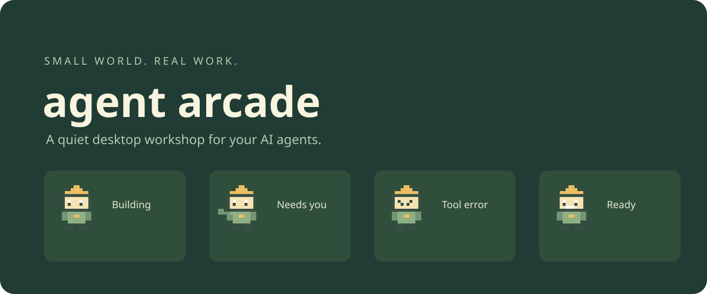
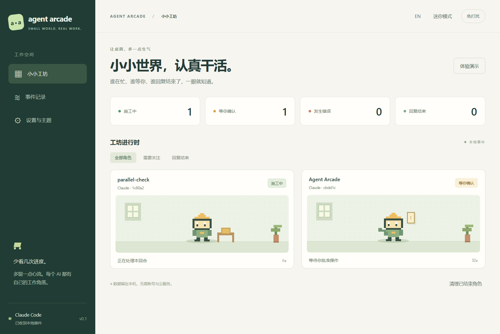

<p align="center"></p>

<p align="center"><a href="README.zh-CN.md">简体中文</a> · <a href="https://github.com/Ray0766/agent-arcade/actions">Build status</a> · <a href="https://github.com/Ray0766/agent-arcade/releases/tag/v0.3.0-preview.2">Public Windows preview 0.3.0-preview.2</a> · <a href="docs/THEMES.md">Make a theme</a></p>

# Agent Arcade

Agent Arcade is an open-source desktop app for chatting with AI characters on your own computer. It is released under AGPL-3.0 with no paid features. The app runs locally and keeps conversations and memory on this computer; the model is called with one API key that you bring (Claude, GPT, DeepSeek, Gemini or Doubao). This describes the **0.4.0-preview.1 development source**, not the older downloadable Windows app. Read the version table below before choosing a route.

**Current local candidate:** `0.4.0-preview.7` is installed on the owner's Mac with a native-menu Quit repair. Two normal quit/reopen cycles leave no observed processes; saved keys/history and a real DeepSeek reply pass. The fixed credential component is unchanged. Personal-use arm64, unnotarized and unpublished. [Source, package hashes and limits](docs/MAC_QUIT_FIX_20261116.md). The table below keeps publicly obtainable versions separate.

## Choose the version first

Availability read-only checked on **2026-11-15**:

| Version | What you can obtain | First-use route |
| --- | --- | --- |
| **Public 0.3.0-preview.2** | [Windows executable, checksum and lockfile](https://github.com/Ray0766/agent-arcade/releases/tag/v0.3.0-preview.2). This is the older WeChat task/observer preview, licensed under MIT. | Use its [version-specific instructions](docs/releases/0.3.0-preview.2.md): WeChat ClawBot pairing and a task backend. It does **not** have the App-first key card described below. |
| **Development 0.4.0-preview.1** | Source on `codex/companion-nine`, with reproducible baseline `3edf1ced8ec2d05fc50be01a163b83cf16d6a7a4` (AGPL-3.0-only). **Not a published release.** | Follow [Run from source](#run-from-source), then [First run](#first-run). |
| **Local signed 0.4.0-preview.7** | Local `codex/mac-quit-lifecycle-20261116`, build source `ec5d79a15de1dac0f20dba94b7a823cf8c724c0a`; fresh arm64 DMG/ZIP, same signer and fixed credential helper. | Installed only on this Mac, unnotarized, no public download. [Complete Quit/reopen and data retention](docs/MAC_QUIT_FIX_20261116.md). |
| **Local signed 0.4.0-preview.6** | Local `codex/stable-credential-broker-20261116`, build source `00e7b31b79f353ed7b28637fa043ef4e21d32619`; fresh arm64 DMG/ZIP and separately pinned local helper. | Installed/verified on this Mac only; unnotarized, no public download. [Initial grant, update checks and remaining gates](docs/MAC_CREDENTIAL_BROKER_20261116.md). |
| **Local signed 0.4.0-preview.4** | Local `codex/api-chat-credentials-20261116`, source `ad1531e4bef53943f0acea34f4a9f917636cc9c7`; rebuilt arm64 DMG/ZIP with the same personal certificate. Unnotarized. | Local only, absent from pinned remote source/public executable. [Exact identity and limits](docs/API_CHAT_CREDENTIALS_20261116.md); the bounded native DeepSeek save/re-save/reply path passes after owner authorization; future-update Keychain prompts and broader human acceptance remain open. |

**There is no publicly downloadable Mac candidate package.** A local build or
an Actions artifact is not a published Mac release. Mac users currently need
source; platform limits and build instructions are in [macOS notes](docs/MACOS.md).
A plain clone without the branch below selects the older default `main`.

The next acceptance path prioritizes **Chinese desktop text companionship for people who already have an API key**. QQ expansion stays frozen and 3D characters remain a later plan; existing Work and channel features are retained. Both languages use the same [first-run guide](docs/FIRST_RUN.md).

## What the development source provides

- **Chat with a character.** After saving one API key, chat with the built-in character on the Chat page. Each character keeps its own history and a memory list you can read, correct and delete.
- **Character library.** Import SillyTavern character cards (PNG or JSON; V1/V2/V3) with first and alternate greetings, lorebooks, author's note, presets, regex scripts, and message edit, regenerate and branches. Card text is used as material only; scripts and extensions inside a card never run. The item-by-item comparison is in [SillyTavern feature parity](docs/SILLYTAVERN_PARITY.md).
- **Group chats.** Put 2 to 8 library characters into one App conversation.
- **Notes and reflection.** Notes are Markdown pages in a local folder. A character can only propose line-level changes, written after you approve them. Reflection turns things you corrected more than once into rule candidates, which also need your approval.
- **Notices.** Let the app watch a calendar (.ics file or subscription link), a folder, or an RSS feed or web page, and tell you by desktop notification or through a character. Nothing is watched by default.
- **Interface.** Three layouts (immersive, messenger, minimal); an accent colour that follows the current character or stays fixed; day and night; English and Simplified Chinese.
- **Optional chat channels.** WeChat ClawBot, QQ, Feishu and others: see [Optional: chat channels](#optional-chat-channels). Everything above works without connecting any of them.
- **Work side.** See the state of local Claude Code sessions (after you install the observer hooks yourself), and a task board where each background Claude Code task runs in its own git worktree and you verify what is handed back.

## Status

The App-first path remains a development candidate:

- **Automated/component and isolated-window evidence:** character cards, lorebooks, presets, sampling, message operations, streaming, groups, notes/reflection, source notices, layouts and task-board dispatch. Real files, SQLite and an Electron window can be used while model replies are still stand-ins; that is not real-model or human acceptance.
- **Bounded real-use evidence from earlier versions:** QQ companion replies with Claude/GPT/DeepSeek, selected local Claude task flows and observer events. These do not accept the new App-first route. See the [nine-feature ledger](docs/COMPANION_ACCEPTANCE.md) and [tracked validation summary](docs/VALIDATION.md#public-first-use-evidence--2026-11-14).
- **macOS:** real-Mac startup, encrypted fake-key storage, stand-in-provider chat and ad-hoc packaging have bounded evidence. Later local ICS/folder checks used temporary files and a fake wording model, not the owner's data. Real models, Keychain/notification dialogs, real Chinese IME and human use remain unaccepted; see [macOS notes](docs/MACOS.md).
- **Real-provider gaps:** Gemini and Doubao credentials/calls, App-first memory/reminder quality and the complete first-run real-key conversation remain unaccepted.

Public evidence is indexed in [docs/VALIDATION.md](docs/VALIDATION.md).
`WORK_LOG.md`, raw `outputs/` receipts and local build paths are private/local
records, not files a fresh clone needs. Local uncommitted repairs are reported
separately there and are not included in the pinned source below.

## First run

**For the development source below, with a fresh profile.** The shared [中文 / English first-run guide](docs/FIRST_RUN.md) covers the exact source, UI and acceptance boundary. For the public
Windows 0.3.0-preview.2 app, use its version-specific instructions in the table.

1. Run `npm start`. It opens **Companion → Chat / 陪伴 → 对话** with an AI-key card.
2. Pick an AI: Claude, GPT, DeepSeek, Gemini or Doubao.
3. Paste that service's API key and choose **Save and start chatting / 保存并开始聊天**. The key is stored on this computer with OS encryption; usage is billed by that service.
4. Start chatting. Messages in the App conversation go to the AI service you chose; this default App-chat path does not require an Agent Arcade server. Optional Messenger and remote-management routes use separately deployed services; see their guides.

Already have a character card? Open Characters, choose "Import a character card…", open the imported character, then choose "Chat as this character".

WeChat, QQ and other channels, and the Work side, can be set up later or never.

## Where data lives

- By default in `~/.agent-arcade/` under your user folder (on Windows, `C:\Users\<name>\.agent-arcade\`); set the `AGENT_ARCADE_HOME` environment variable to use another location. It holds settings, conversations and memory (SQLite), the character library, notes and saved credentials.
- API keys and chat tokens are stored with OS encryption. Observer data is plain JSON and is not encrypted.
- Deleting this folder deletes characters, memory and credentials with it. More detail is under [Observer privacy](#observer-privacy).

## Run from source

Requires Git; use [Node.js 24.18+ within the 24.x line](https://nodejs.org/)
for the documented development/test route. The pinned package declares a
22.13 minimum, but that is not the complete-suite test requirement. Use a **new directory** for these
commands; do not switch or reset an existing checkout with local changes.
The detached checkout pins the documented remote baseline rather than any
later branch changes or the maintainer's uncommitted repairs.

```sh
git clone --branch codex/companion-nine --single-branch https://github.com/Ray0766/agent-arcade.git agent-arcade-companion
cd agent-arcade-companion
git checkout --detach 3edf1ced8ec2d05fc50be01a163b83cf16d6a7a4
git rev-parse HEAD
npm ci
npm start
```

`git rev-parse HEAD` should print `3edf1ced8ec2d05fc50be01a163b83cf16d6a7a4`;
[the exact source tree](https://github.com/Ray0766/agent-arcade/tree/3edf1ced8ec2d05fc50be01a163b83cf16d6a7a4)
contains package version `0.4.0-preview.1` and the App-first card. Neither that
version string nor a successful build means a release was published.

- `npm start` runs `electron .`: the app itself, using the data folder above.
- `npm run demo` runs `electron . --demo`: the same app, except that Work › Sessions shows built-in sample sessions (kept apart from live observations); while in demo state it sends no desktop notifications, loads no notice sources and runs no scheduled reflection. It still uses the same data folder; it is not an isolated trial environment.
- The app is single-instance: close a running one before starting another.
- `npm ci` does not download voice models; optional local voice is described in [voice setup](docs/VOICE_LOCAL_SETUP.md).
- Test and check commands are under [Develop](#develop).

## Optional: chat channels

The App conversation works without any channel. What follows is the existing material on connecting a character to WeChat, QQ and other chat software, and on giving tasks by chat message. It was written earlier than the sections above; its scope and evidence are in the documents it links to.

**QQ today:** ordinary QQ is bridged through an unofficial NapCat / OneBot component that you supply. On 2026-11-12 the NapCat upstream repository was reduced to a README and stopped publishing releases (checked through the GitHub API on 2026-11-13), so the in-app download of that component can no longer succeed. QQ is therefore an optional capability kept for people who already have the component, and is not being extended. Agent Arcade neither bundles nor uses NapCat source; see [third-party notices](THIRD_PARTY_NOTICES.md).

Once QQ is connected, each character has an independently logged-in QQ account, a continuing conversation with its owner, editable memory and optional proactive contact, agreed follow-ups and public diary posts. Characters and AI providers are separate choices. Companion conversations have no file or shell tools; coding tasks remain a separate mode. Full account autonomy, ordinary personal WeChat and Moments are not implemented. [Companion setup and boundaries](docs/COMPANION.md).

**Real evidence, 2026-11-05:** Ju/Claude API, Dragon Girl/GPT API and Whale Girl/DeepSeek have each replied through actual owner QQ conversations and run together in one app. Bounded flows passed for follow-ups, corrected/forgotten memory and recall after restart, short bubbles, native character cards, consecutive-message batching and three-account isolation/reconnect. One Qzone post was published, read back and seen by the owner; a later draft continued its theme after app restart. These companion-chat results do not accept the corresponding providers' coding or file-tool flows. [Nine-feature acceptance ledger](docs/COMPANION_ACCEPTANCE.md).

**The nine-feature milestone is unfinished.** Non-owner post visibility and suppression of a known remaining bubble queue still need real acceptance. Hands-free spoken interruption is deferred at the owner's request and remains unaccepted. QQ logins have also expired during testing; a successful reconnect is not a persistent-login guarantee. Desktop voice offers optional local **Qwen ASR + GPT-SoVITS**, with Windows speech as an explicit fallback. In the corrected local build, the owner confirmed one manual recording produced accurate text and an audible gentle female reply; its diagnostic export independently recorded review, confirmation and completed playback without errors. This accepts one manual flow, not hands-free interruption, repeated reliability or accuracy rates. Optional models require separate setup and are not downloaded automatically. [Voice setup and limits](docs/VOICE_LOCAL_SETUP.md), [live acceptance](docs/COMPANION_ACCEPTANCE.md).

The owner has chosen to finish implementation first, then run the remaining real flows together. Those checks are deferred, not passed. A group is a possible future testing environment; **group-chat integration is not implemented**, and the current configured private-owner scope remains in force. [Consolidated test checklist](docs/COMPANION_TEST_STAGE.md).

| Start here | Entrance and guide |
| --- | --- |
| Choose day or night | **Settings → Appearance**: Day, Night or Follow system. Original typography and portraits remain; pages and dialogs share paired palettes with distinct lightweight ornaments. Available in the local development build. [Appearance and evidence](docs/APPEARANCE.md). |
| Chat inside the app | **Chats → App conversation** uses saved AI credentials without starting QQ, with separate local history and drafts. [Desktop conversation](docs/DESKTOP_CHAT.md). |
| Use QQ in the same window | **QQ accounts → Local components → Manual QQ client** opens a separately prepared fixed SSQQ frontend. Real owner-text delivery and view preference reopening passed; external avatars/media remain restricted. [Manual client](docs/QQ_MANUAL_CLIENT.md). |
| Ask about a QQ picture | Send one JPG/PNG or explicitly quote one picture in the owner's private chat. Claude API and DeepSeek Flash have bounded live picture/quote evidence; broader support remains limited. [Picture input](docs/QQ_INBOUND_IMAGES.md). |
| Try without an account | **Work › Work & results → Try local sample** checks real bundled sample text. Open its result to inspect the content, byte count and SHA-256, or format its JSON. No API key, project folder or AI request is needed; this is a local file check, not a simulated AI conversation. |
| Connect a character | Prepare an AI, open **QQ accounts**, start/sign in to an account from an existing component installation, then link the companion. An online card offers **Connect AI** for a verified binding, or **Verify and connect AI** for one eligible configured candidate. Both reuse saved settings and credentials; an empty saved-key input does not clear the key. Ambiguous bindings still require choosing a companion. Manual bridge settings remain under advanced configuration. [Setup](docs/COMPANION.md#setup), [QQ integration](docs/QQ_INTEGRATION.md). |
| Shape your conversations | **Together**: memory, agreed follow-ups, her journal and character cards. [Feature entrances](docs/COMPANION.md#nine-source-features-and-their-entrances). |
| Read owner QQ messages | **QQ accounts → selected companion’s More → QQ message history**. Explicit recent/older-page reads and on-demand picture previews, with comfortable/compact spacing. Closing clears the view; history is not added to AI memory. Bounded real three-page navigation and one picture preview passed; broader reliability remains unverified. [History guide](docs/QQ_OWNER_HISTORY.md). |
| Try desktop voice | **Chats → App conversation → Voice chat** after starting App chat, without QQ; or the existing connected-channel voice entrance. [Optional local voice](docs/VOICE_LOCAL_SETUP.md), [recording and review](docs/VOICE_AND_CHARACTER_CARDS.md). |
| Share an image | Connected QQ companion → **Share image**, review the preview and owner account, then send. [Image support and evidence](docs/QQ_MEDIA.md). |
| Send a QQ voice clip | Connected QQ companion → **Share voice**: choose a supported WAV, or type a short text with separately configured local TTS. Preview it, then explicitly send to the owner. This does not start desktop recording. [Voice clips and limits](docs/QQ_VOICE.md). |
| Review friend requests | Select the companion, save its exact QQ/owner binding, then open **QQ accounts → Friends and groups → Friend requests** for the signed-in QQ. Before connecting AI, a temporary session listens only for the saved owner's new request; an already connected companion uses its current inbox. Accept/Decline is explicit and never connects AI or grants new chat permission. Implemented in the local candidate; real QQ handling remains pending. [Guide](docs/QQ_FRIEND_REQUESTS.md). |
| Inspect group members | **QQ accounts → Friends and groups → Groups → View members**. Same-window read-only roster, search and return. One actual 23-member group and self-search passed; large lists and group writes remain unaccepted. [Guide](docs/QQ_GROUP_MEMBERS.md). |
| Manage installed plugins | **QQ accounts → Local components → Manage plugins**. Inspect the fixed supported registry and preview enable/disable changes with shared-account impact. Cleaner 1.2.0 installation, default save/restart/readback and explicit disable passed in one bounded real flow; actual cleanup and other plugins remain unaccepted. [Guide](docs/QQ_PLUGINS.md). |
| Read incoming QQ voice | Disconnected companion → **Connect companion → Companion → Understand my QQ voice messages**, save, then reconnect. Optional local ASR; text replies, no voice-triggered commands. Cold-start latency and real QQ codec acceptance remain limitations. [Guide](docs/QQ_INBOUND_VOICE.md). |
| Manage QQ backgrounds | **QQ accounts**: lifecycle, diagnostics, configuration backups and component versions; inspect and explicitly clear verified leftovers after an app crash. [Recovery](docs/QQ_RECOVERY.md), [component selection/rollback](docs/QQ_COMPONENT_SELECTION.md). |
| Change a QQ profile | Select the companion → **QQ accounts → More → QQ profile**. Read and preview a nickname/signature change, or choose and preview a square avatar image, then confirm. AI can stay disconnected. One account's nickname/avatar changes and explicit restorations were also seen in ordinary QQ; broader synchronization is not guaranteed. [Profile](docs/QQ_SELF_PROFILE.md), [avatar](docs/QQ_AVATAR.md). |
| Give coding tasks or observe work | Use the separate task mode below, or install observer hooks from **Settings → Claude Code observer**. [Task modes](#give-the-bot-a-task), [observer status](#what-an-observer-status-actually-means). |
| Maintain a remote installation | Source entrance: **QQ accounts → Remote instances → Remote QQ process**. Optional previous-run cleanup and native WebUI Passkey maintenance share the same window and have separate host enablement. Real remote-host acceptance is pending. [Cleanup](docs/QQ_REMOTE_ORPHAN_CLEANUP.md), [Passkeys](docs/QQ_PASSKEY_MANAGEMENT.md). |

**Characters and connections:** original anime portraits default to Ju for Claude, Dragon Girl for GPT/Codex and Whale Girl for DeepSeek; Sprout and pixel scenes remain available. Source adapters cover WeChat **ClawBot**, personal QQ through a local OneBot bridge, local Claude Code, local Codex, Claude API, GPT API and DeepSeek API. New source integrations add [Gemini API](docs/GEMINI.md), [Doubao/Ark API](docs/DOUBAO.md) and a fixed-owner [Feishu enterprise bot](docs/FEISHU.md); these still need real provider/account acceptance and are not ordinary personal Feishu accounts. Local Codex remains a coding option, not a verified tool-free companion backend. [X standard DMs](docs/X.md) now have an experimental fixed-owner source entry, with a separate user token, paid API reads/writes and persistent `/unsubscribe`; platform conditions and real-account acceptance remain pending. The experimental [Messenger Page](docs/MESSENGER.md) source uses a separately deployed HTTPS relay, Page credentials and a fixed owner; it is not personal Facebook login, and real authorization, deployment and delivery remain unverified. Each companion is restricted to its configured private owner. [Personas](docs/PERSONAS.md), [channel/backend boundaries](docs/CHANNELS_AND_AI.md).

**Coding evidence is separate:** local Claude program mode passed bounded real QQ and WeChat ClawBot chat and approved-file flows without Channels startup confirmation. Local Codex passed direct-run chat, file and interruption checks; that is not a QQ/WeChat coding round trip. DeepSeek's approved-file check used a real API with a simulated messaging transport. The newer GPT/DeepSeek QQ companion replies above do not upgrade those task boundaries. [Claude program mode](docs/CLAUDE_PROGRAM.md), [Codex](docs/CODEX.md), [GPT](docs/GPT.md), [DeepSeek](docs/DEEPSEEK.md).

**Published preview: 0.3.0-preview.2 · Windows first.** Its local Claude mode uses the official Channels research preview and requires explicit confirmation in the original CLI. The newer source/local-build capabilities described above are **not a claim that the published preview.2 installer contains them**. Historical Channels and subsequent program-mode results retain their separate scope in [validation](docs/VALIDATION.md).

### Give the bot a task

**New source capabilities:** **Work & results** adds scoped official session checks, experimental owned-background-session control, and an offline interactive artifact viewer backed by MCP Apps/Tasks. WeChat accepts supplied voice transcription and quoted context; a SQLite receipt ledger preserves deduplication and marks interrupted work for review. Background Channels and phone voice/quote delivery still need live acceptance. These changes are not in the published preview.2 installer. [Implementation, evidence and limits](docs/TECHNOLOGY_IMPLEMENTATION.md).

Run `npm start` and prepare the AI under **Work › Channels**. For WeChat, find **ClawBot** in **WeChat → Me → Settings → Plugins**, then scan and confirm the app's pairing code there. For QQ, open **QQ accounts** to manage an existing local component installation, sign in to the intended ordinary QQ account, and bind it to the companion. The separate [complete-runtime setup route](docs/QQ_NODE_SETUP.md) retains its first native-startup failure as historical evidence; the repaired isolated start, QR display, stop and return flow subsequently passed. Node login/chat and clean-Windows first success still need acceptance. The [single-window setup](docs/QQ_INTEGRATION.md) explains the verified existing-installation route, and the [advanced bridge route](docs/QQ.md) remains available. Choose a disposable project and the coding mode before accepting work:

| Method | Setup and authority | Stopping work |
| --- | --- | --- |
| **Local Claude · program mode** | Install and sign in to original Claude Code (tested 2.1.317), select this mode and start receiving messages. No extra API key or Channels startup prompt. Each tool action needs a one-time approval. [Details](docs/CLAUDE_PROGRAM.md). | `停止` / `/cancel` interrupts this turn and checks owned-process exit; `/new` starts a separate conversation. Independent background jobs are unverified. |
| **API agent** | Save your Anthropic API key, then start receiving tasks. The SDK asks for each tool action through a one-time code. API billing applies. | `/cancel` aborts the app-managed run and clears its queue. |
| **Claude Channels · manual startup** (legacy) | Install Node.js 22.13+ and Claude Code 2.1.317+, log in through the original CLI, then connect the selected channel and choose **Open Claude**. Personally confirm its custom development channel. No additional API key is required. | Current source: `停止` or `/cancel` force-stops this app instance's verified CLI process tree; `恢复会话` or `/resume` reopens its recorded UUID. Manual/unowned launches only pause forwarding. |
| **Local Codex** | Install and sign in to the original Codex CLI. The app uses its structured App Server interface and existing login; workspace permissions follow Codex's native rules. [Setup](docs/CODEX.md). | `停止` / `/cancel` interrupts the exact current turn and waits for its completion event; `/new` starts a new conversation. |
| **GPT API** | Save a separate OpenAI API key; choose GPT-6.1 Sol or GPT-6 Astra. Approved project file tools, no shell. API billing applies without a dollar-cost cap. [Setup](docs/GPT.md). | `停止` / `/cancel` cancels local processing and pending approval, without rollback or confirmation of remote billing cancellation. |
| **DeepSeek API** | Save a separate DeepSeek API key. Approved Read/Write/Edit/List tools are available; shell commands are not. API billing applies, without a dollar-cost cap. [Setup](docs/DEEPSEEK.md). | `停止` / `/cancel` aborts the request and pending approval; existing file changes are not rolled back. |

Disconnect before switching channels or backends; provider keys are retained separately. Claude program mode asks for each tool action; Codex and legacy Channels follow their native permission rules, so some permitted actions may run without another chat prompt. Channels may combine messages in one session. Keep the computer/app running; only legacy Channels requires its original interactive terminal to remain open. Messages pass through Tencent and the selected AI provider, and the QQ bridge processes QQ traffic. **Replies and accepted sends never prove task success.** See the channel/backend guides for their different permissions, stopping behavior and limits.

Legacy Channels chat stays quiet on successful receipt and returns the agent's reply text directly; permissions and actionable failures still appear. Its launch command pre-allows only `mcp__agent-arcade-wechat__reply` for that session, subject to the CLI's deny/ask rules and hooks. It skips no general permissions and writes no permanent allow setting. Connection/MCP counters stay in the desktop's **Connection details**.

The current source also accepts `同意 CODE` / `拒绝 CODE` using short, single-use permission codes; `状态` resends a pending request without extending its expiry. Force stop is not graceful cancellation or rollback, and independent background jobs are not confirmed stopped. Legacy Channels resume and its bounded 30-second local-channel retry never replay offline input. Program mode does not automatically resume a conversation after app restart. **The controlled live pass covers one Windows/current-account native flow; real network-loss/sleep recovery remains untested. These changes are not in the published preview.2 binary.** [Current evidence and limits](docs/VALIDATION.md#wechat-control-and-recovery--localsource-2026-11-04).

### External tool versions and observer install

When installed from source, the Claude API task mode uses Claude Agent SDK 0.3.317 / its native runtime 2.1.317 (a proprietary optional dependency: installed by `npm ci`, not shipped in packaged builds); both local Claude routes use your separately installed [Claude Code](https://code.claude.com/docs/en/overview) 2.1.317+. Codex uses its separately installed original CLI; DeepSeek uses its own API key. The independent observer supports Claude terminal versions 2.1.277+ (real acceptance: 2.1.317). Observer hook commands use exec form, without a shell. Local Codex remains coding-only.

A local check that needs no account: under **Work › Work & results** choose **Try local sample**. The app reads a real sample text and shows its content, byte count and SHA-256 in the built-in viewer; **Choose text file** lets you inspect your own file afterward. This is a local file check and makes no AI call.

For the separate Claude Code observer, open **Settings → Install hooks**, then restart Claude Code and submit a prompt. Use several Claude Code sessions or launch subagents to populate more stations. **Return to live sessions** exits the sample observer view.

The installer merges observer commands into `~/.claude/settings.json`, backs up existing settings, and copies the observer into `~/.agent-arcade/bin/`. Removing hooks leaves unrelated hooks intact. No terminal command is approved or executed by clicking a character; respond to approval prompts in Claude Code itself.

## Work side: the Claude Code observer

- Separate stations for sessions and subagents, with names, event timestamps, and recent history.
- Original **Sprout Bot** pixel art, Moss Workshop and Lunar Post themes; state labels work without color or animation.
- Silent desktop notifications, opt-in; focus suppression, a per-agent cooldown, and quiet mode.
- A compact always-on-top window; close-to-tray when the platform supports a tray icon.
- Click a delivered parcel to inspect a final reply, if local result capture was enabled beforehand.
- English and Simplified Chinese, keyboard controls, and reduced-motion support.
- Declarative JSON themes with no JavaScript, remote images, or remote fonts.

## What an observer status actually means

| Observed event | Scene | Meaning |
| --- | --- | --- |
| `UserPromptSubmit`, `PreToolUse`, `PostToolUse`, `SubagentStart` | Building | Activity observed; not a progress percentage |
| `PermissionRequest`, `AskUserQuestion`, relevant `Notification` | Needs you | Return to Claude Code to respond |
| `PostToolUseFailure` | Error observed | A tool failed; the agent may recover on its next action |
| `StopFailure` | Error observed | A turn ended with an API failure |
| `Stop`, `SubagentStop` | Response ended | A response boundary, **not proof the requested work succeeded** |
| `Stop` with background work / scheduled wakeup | Building / Idle | Do not claim all work has finished |
| `SessionEnd` | Ended | Session closed; unfinished children become uncertain |
| No event for five minutes while active | Uncertain | The last state may be stale; never auto-completed |

Multiple pending tool permissions are tracked separately. Old events and duplicate delivery cannot replace newer state. Events are observed at hook time: another Stop hook can continue a turn, a long-running tool can become uncertain, and user interruptions do not always emit a terminal event. See [accuracy notes](docs/ARCHITECTURE.md).

Approval itself has no follow-up hook: a permission request remains visible until the next tool/result event. Ambiguous permission matching is shown as uncertain. The persistent scene's benefit over notification-only tools is a hypothesis, not a completed user study.



Real Claude Code 2.1.317 events with harmless synthetic commands, not demo mode. [Recovery and response-boundary evidence](docs/VALIDATION.md).

## Observer privacy

The independent **observer mode** needs no account or cloud service and adds no telemetry/server/listener. It stores a project **folder name**, session/agent IDs, event names, tool names/IDs and timestamps. It drops prompts, tool arguments, raw errors, and transcript paths. Final reply text is **off by default** and capped at 16,000 characters when enabled. Observer data is ordinary unencrypted local JSON. **Chat integrations have different data flows:** Tencent and the selected AI provider receive messages/model input; the local QQ bridge also processes QQ traffic. Saved messaging tokens and provider keys use OS encryption. Legacy Claude Channels adds an authenticated loopback broker and private MCP launch file; [Claude program mode](docs/CLAUDE_PROGRAM.md) instead controls the original CLI through its structured process protocol. Neither local route reads login credentials. Companion history, editable facts and follow-ups are stored locally in SQLite and are separate from observer capture. The SDK and original CLIs may retain their own session content. See [companion storage](docs/COMPANION.md), [WeChat](docs/WECHAT.md#privacy-restart-and-failure), [QQ](docs/QQ.md), [Codex](docs/CODEX.md), [GPT](docs/GPT.md) and [DeepSeek](docs/DEEPSEEK.md).

The observer inbox is bounded to roughly 2,000 files/24 hours while hooks run; the app retains at most 200 stations and 30 events per station. Turning off observer capture clears saved observer reply text. **Clear ended sessions** removes response-ended/session-ended stations; neither action clears companion memory. Deleting the entire default `~/.agent-arcade/` directory also removes saved companion configuration, credentials and memories there, not just observer data. Use the app's scoped controls for ordinary cleanup. Hook backups remain beside Claude settings.

## Develop

Use Node **24.18+ in the 24.x line** for the complete suite. Install the optional
transfer service's separate locked dependencies before its integration tests;
this does not start a listener or install a remote service.

```sh
npm ci --prefix deploy/transfer-helper --ignore-scripts --omit=optional --no-audit --no-fund
npm test           # Node's built-in runner, after npm ci
npm run check      # JavaScript syntax checks
npm run test:transfer-helper # isolated HTTPS/filesystem/crash checks
npm run test:ui    # isolated Electron + installed hook smoke test
npm run test:bot-ui # actual bot UI / OS vault, no paid model
npm run test:bot-flow # clearly marked mock transport/model flow
npm run test:native # Electron + Node MCP sidecar fixture, no model/WeChat
npm run dist      # package for the current OS
```

Direct development dependencies and the resolved `package-lock.json` are committed. Use `npm ci` to reproduce that dependency graph. macOS/Linux packaging is configured but is not included in the Windows acceptance target.

Read [CONTRIBUTING.md](CONTRIBUTING.md), the [theme format](docs/THEMES.md), [architecture](docs/ARCHITECTURE.md), and [security policy](SECURITY.md). The first priority is reliable observation. Additional tools, clickable IDE navigation, richer themes, signed installers, and automatic updates are future work.

The working-desktop revision and inspected design/HCI references are recorded in [UI_REFERENCES.md](docs/UI_REFERENCES.md). See the [technology review](docs/TECH_RADAR.md) for researched options, evidence and adoption limits; candidate features are not implemented capabilities.

## Credits and license

Agent Arcade is fully open source under the **GNU AGPL-3.0** ([LICENSE](LICENSE)); there are no paid features. Revisions published before 2026-11-13 were MIT licensed and remain so ([historical text](LICENSE-MIT-HISTORICAL)). Code adapted from SillyTavern is recorded in [src/vendor/sillytavern](src/vendor/sillytavern/README.md). Sprout Bot and workshop art are drawn in `scripts/create-assets.cjs`; no third-party game characters or sounds are used. Dependencies retain their own licenses; the optional Claude Agent SDK is not part of the AGPL distribution and is subject to Anthropic's separate terms, see [third-party notices](THIRD_PARTY_NOTICES.md). This community project is not affiliated with Tencent, Anthropic or PeonPing.

## Agent guidance

Before contributing, read [AGENTS.md](AGENTS.md) and the [project quality brief](docs/QUALITY_BRIEF.md) alongside CONTRIBUTING.md. They define research, differentiation, design references, and evidence required for future changes while preserving the current architecture and original artwork.

Maintainer preparation: [labelled demo, human acceptance and first-user follow-up (unpublished draft)](docs/ADOPTION_TRIAL_KIT.md). No trial or release is implied.
