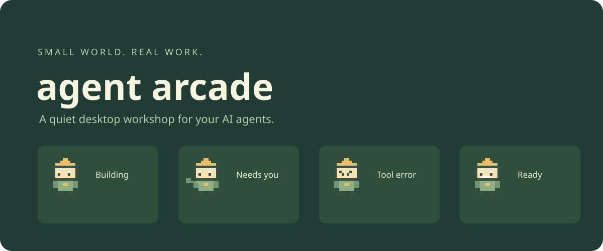
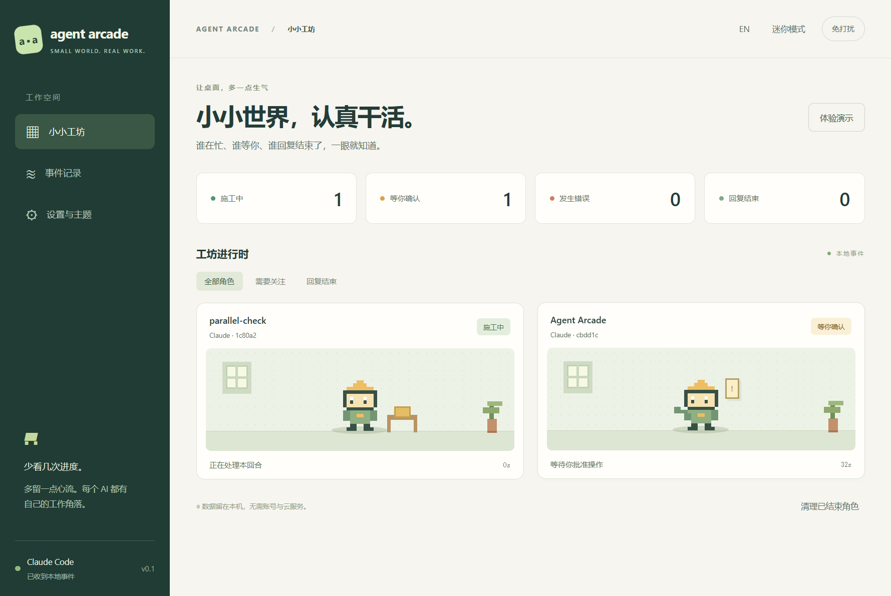

<p align="center"></p>

# Agent Arcade

**发条微信，让 Agent 在电脑上接任务、问问题、交结果。**

[English](README.md) · [构建状态](https://github.com/Ray0766/agent-arcade/actions) · [下载](https://github.com/Ray0766/agent-arcade/releases) · [制作主题](docs/THEMES.md)

实验性的 **微信派活 Bot** 保留两个入口：由应用管理的 **API Agent**，以及复用既有登录的 **本机 Claude Code CLI**。扫码配对自己的微信、选择本机项目，再在 ClawBot 对话中派任务。延续 Electron、原创 Sprout Bot 与两套主题；原有 hooks 观察功能仍可独立使用。

**当前版本：0.3.0-preview.2，优先支持 Windows。** 本机模式采用官方 Channels 研究预览，首次需在原版 CLI 中明确确认。2026-11-04 已用 preview.1 跑通本机微信最小闭环，独立检查了实际文件，主人也确认手机收到回复。**本版普通回复的权限调整仍待真实复验，API 模式真实闭环仍未验收。** 见[验证说明](docs/VALIDATION.md)。

## 给 Bot 派活

先在手机微信 **我 → 设置 → 插件** 找到 **ClawBot**。电脑运行 `npm start`，进入 **微信派活 → 连接微信** 生成二维码，用手机 ClawBot 页面上的扫码功能扫描并确认。聊天入口是 **ClawBot 对话**。选择一次性测试项目，再选执行方式：

| 入口 | 配置与权限 | 停止方式 |
| --- | --- | --- |
| **API Agent**（默认） | 保存 Anthropic API key 后接收任务。SDK 对每次工具操作请求一次性确认，使用 API 计费。 | `/cancel` 中止应用管理的执行并清空队列。 |
| **本机 Claude Code CLI** | 安装 Node.js 22.13+ 和原版 Claude Code 2.1.317+，在 CLI 自行登录。开启本机模式后，把页面生成的命令复制到终端，亲自确认自定义开发通道。Agent Arcade 不要求额外 API key。 | `/cancel` 仅暂停转发并发送待决权限的拒绝；真正停止执行请在本机 CLI 按 **Ctrl+C**。 |

先断开再切换模式，已保存的 API key 会保留。本机模式沿用原版 CLI 的权限设置，已有允许规则可能自动执行；多条微信消息也可能在同一会话中合并处理。运行时电脑和应用需保持开启，本机模式还需保持 CLI 终端运行。消息与输出会经过腾讯及 Anthropic；批准的 Windows 命令可能影响项目目录以外的内容。**收到回复或平台受理回传，都不代表任务已验收成功。** [完整步骤、费用和限制](docs/WECHAT.md)。

本机模式收到并转发普通消息后保持安静，直接回传 Agent 的回复正文；权限请求和需要处理的异常仍会提示。启动命令仅在本次会话允许 `mcp__agent-arcade-wechat__reply`，仍受 CLI 的 deny/ask 规则与 hooks 约束，不跳过其他权限，也不写入永久允许设置。MCP 与转发计数放在桌面的“连接详情”中。

## 启动

从源码运行需要 [Node.js 22.13 或更新版本](https://nodejs.org/)。API 模式自带 Claude Agent SDK 0.3.317 / 其原生运行时 2.1.317；本机模式使用你单独安装的 Claude Code 2.1.317+。独立观察器支持终端版本 2.1.277+（真实验收为 2.1.317）；hooks 直接调用进程，无需 shell 解析：

```sh
git clone https://github.com/Ray0766/agent-arcade.git
cd agent-arcade
npm ci
npm run demo
```

无需安装依赖的视觉预览：用浏览器打开 `src/ui/index.html`。这个入口只展示演示数据，连接真实会话需要桌面程序。

运行 `npm start`，进入 **设置与主题 → 安装钩子**，重启 Claude Code 后提交新任务。可以同时打开多个 Claude Code 会话；子任务也会独立出现。演示模式与真实任务完全分开，点击“返回实时”查看真实事件。

安装会合并 `~/.claude/settings.json`，备份原配置，并将观察脚本复制到 `~/.agent-arcade/bin/`。卸载只移除本项目的 hooks，保留其他配置。点击角色不会批准或执行命令，操作确认仍在 Claude Code 内完成。

## 首版功能

- 多会话、子任务独立角色，状态文字、最近事件与时间可查。
- 原创 Sprout Bot 像素角色、苔藓工坊与月球邮局两套主题。
- 桌面通知默认关闭，启用后保持静音；前台抑制、通知冷却、免打扰。
- 迷你模式、窗口置顶、支持时关闭到托盘。
- 可选择保存最终回复，点击包裹查看；中英文界面与减少动画支持。
- 无脚本的 JSON 主题格式，社区可替换配色与七种状态的像素图。

## 状态必须说实话

| 场景 | 依据与边界 |
| --- | --- |
| 施工中 | 收到提交、工具调用或子任务开始事件；不表示完成百分比 |
| 等你确认 | 收到权限请求、询问或相关通知，请回 Claude Code 处理 |
| 发生错误 | 区分工具调用失败与回合 API 失败，后续活动可恢复 |
| 回复结束 | 收到回复边界，不代表代码通过测试或任务已验收 |
| 待确认 | 活跃状态超过五分钟没有新事件，或中断/父会话关闭后结果未知 |

后台任务未结束时不显示全部完成；定时唤醒单独显示待命。多个工具并发时，其他工具的完成不会清除仍在等待的批准。`Stop` 钩子发生时，其他钩子仍可能让回合继续，因此本项目保留事件记录并及时修正状态。

批准动作本身没有后续 hook，权限请求会保留到下一条工具或结果事件；无法唯一关联时显示待确认。比单独通知更快定位、打扰更少，仍是待做用户对照的假设。



上图来自 Claude Code 2.1.317 的真实事件与无副作用测试命令，未使用演示模式。[查看恢复与回复边界证据](docs/VALIDATION.md)。

## 隐私与开源

独立的**观察器模式**无需账号或云服务，不添加遥测或网络监听。默认只记录项目文件夹名、会话与任务 ID、事件、工具名称/ID、时间，丢弃提示词、工具参数、完整路径和原始报错。最终回复需单独开启保存，最多 16,000 字符；观察器数据是本地普通 JSON，不加密。**微信模式的数据流不同**：消息/模型输入经过腾讯及 Anthropic，已保存的微信/API 凭证使用系统加密。本机模式增加临时认证的本地回环服务与私有 MCP 启动配置，不读取 Claude 登录凭据；SDK 与原版 CLI 分别保留各自会话内容。[具体隐私、删除与重启行为](docs/WECHAT.md#privacy-restart-and-failure)。

界面最多保留 200 个角色，每个角色保留 30 条事件；离线队列约 2,000 条，钩子运行时清理超过 24 小时的记录。关闭回复保存会清除已保存的文本；“清理已结束角色”移除回复或会话结束的角色。卸载 hooks 并退出后，可删除 `~/.agent-arcade/` 清除数据。Claude 配置旁的备份需要自行保留或删除。

```sh
npm test
npm run check
npm run test:ui
npm run test:bot-ui
npm run test:bot-flow
npm run test:native
npm run dist
```

直接依赖已固定版本，实际解析的 `package-lock.json` 已入库，可通过 `npm ci` 复现依赖。macOS/Linux 提供构建配置，尚不属于 Windows 验收范围。

原创源码、文档和美术资产为 **MIT 许可证**。依赖保留各自许可，捆绑的 Claude SDK/运行时适用 Anthropic 的独立条款，见[第三方说明](THIRD_PARTY_NOTICES.md)。欢迎贡献真实微信验收、状态误报复现和主题。更多集成、IDE 跳转、签名安装包与自动更新留待后续验证。本项目与腾讯、Anthropic、PeonPing 无隶属关系。

## Agent 开发规范

后续开发请结合 [AGENTS.md](AGENTS.md)、[项目质量 brief](docs/QUALITY_BRIEF.md) 与 [贡献规范](CONTRIBUTING.md)：核实技术选择与参考作品，验证差异化价值，在现有架构和原创美术基础上完成实现与验收。

本次工作台改版的获奖作品、官网与 HCI 论文参考见[设计记录](docs/UI_REFERENCES.md)；新技术的收益、兼容性及采用边界见[技术调研](docs/TECH_RADAR.md)。调研候选不表示已经实现。
