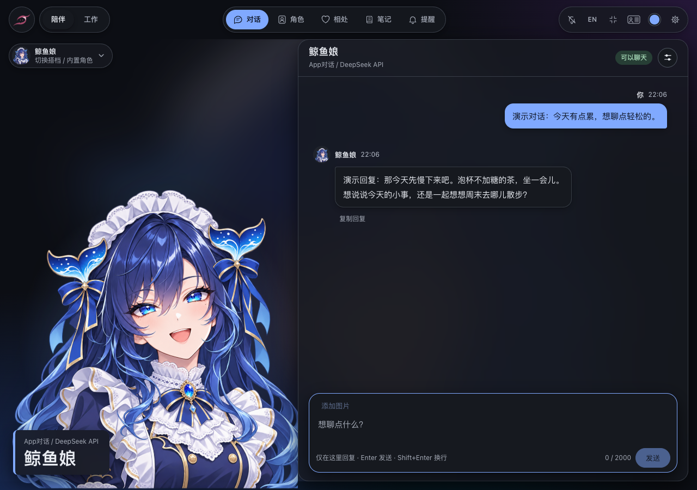
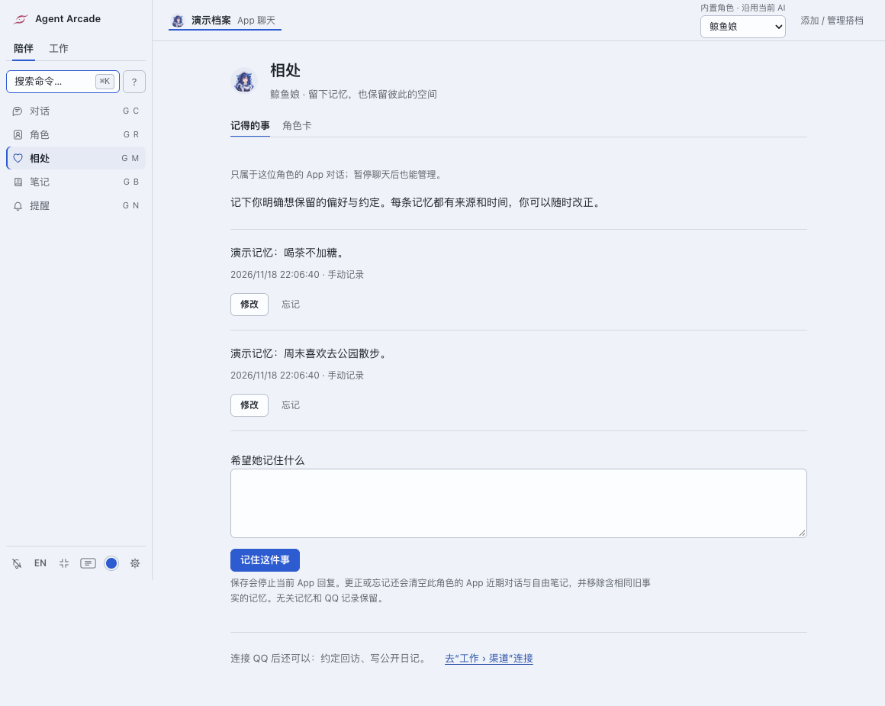

<p align="center"></p>

# Agent Arcade

**在桌面上和 AI 搭档聊天，把对话和记忆留在自己的电脑里。**

自带一个 API key，选一个角色，就能在同一个 App 里开始文字对话。Agent Arcade 在本机保存聊天记录和记忆，消息发送给你选择的 AI 提供商。应用以 AGPL-3.0 完全开源，不设收费功能；API 用量由提供商另行计费。

[English](README.md) · [首次使用](docs/FIRST_RUN.md) · [构建状态](https://github.com/Ray0766/agent-arcade/actions) · [验证记录](docs/VALIDATION.md)



*preview.8 当前生产渲染界面，使用独立演示数据；不是私人聊天，也不是真实模型回复的验收证据。[配图来源与复现](docs/README_MEDIA.md)。*

## 可以做什么

- **直接在 App 里聊。** 通过 API 使用 Claude、GPT、DeepSeek、Gemini 或豆包，不需要先接 QQ、微信、项目目录或观察器 hooks。陪伴对话不开放文件和终端工具。
- **切换搭档。** 保留当前 AI 提供商和密钥，切换内置人设。每个人设有自己的 App 聊天记录与记忆；另建的搭档档案还会隔离凭据。
- **自己管理记忆。** 查看、添加、纠正和遗忘 App 事实，操作针对当前搭档。[对话与记忆说明](docs/DESKTOP_CHAT.md)。
- **带上自己的角色卡。** 导入 SillyTavern PNG／JSON 卡片、世界书和预设，使用已支持的消息编辑、重新生成、分支及角色库群聊。导入卡片里的脚本和扩展不会执行。[逐项功能边界](docs/SILLYTAVERN_PARITY.md)。
- **按需增加上下文。** 日历、文件夹及订阅源提醒默认关闭；共享笔记与反思建议由主人批准后才生效。[陪伴功能](docs/COMPANION.md)。
- **保留工作入口。** 查看 Claude Code 会话事件、检查本地产物，或使用已有的 worktree 任务看板。回复结束或任务交回，不等于通过验收。[任务看板](docs/TASK_BOARD.md)。

沉浸式、聊天应用式、极简工具式三种布局共用“陪伴”和“工作”区；支持日间、夜间、跟随系统，以及跟随角色或自定义强调色。

## 用一个 API key 开始

以下适用于下文开发源码与新档案：

1. 启动应用，进入 **陪伴 → 对话 / Companion → Chat**。
2. 选择 AI，粘贴该服务的 API key。
3. 点击 **保存并开始聊天 / Save and start chatting**，再发送一条消息。


*当前首用界面，使用空白演示档案；没有真实密钥、登录或模型请求。*

消费端订阅不等于 API 余额。默认 App 对话直接调用所选提供商，不需要 Agent Arcade 服务器；可选的转发和远程管理路线需要另行部署。中英文共用的[首次使用指南](docs/FIRST_RUN.md)说明操作与恢复边界。

已有角色卡：进入“角色”，导入 PNG／JSON，选择“用这个角色聊天”。语音和社交渠道都是单独设置的可选入口。

## 看得见，也能改的记忆

进入 **相处 → 记得的事 / Together → Memory**，查看当前人设的 App 记忆；若界面同时提供渠道来源，请选择 **App 记忆 / App memory**。可以添加、纠正或遗忘，不需要先配置社交账号。App 记忆与渠道记忆分开；操作前请核对选中的来源。纠正或遗忘还会清理该人设的近期 App 对话与自由笔记，避免再次提供旧事实；其他人设与 QQ 记录保留。



*生产渲染界面中的演示事实，用于说明操作入口；图片不代表模型召回质量已验收。*

本机 preview.8 已通过真实 DeepSeek 的有界流程：手动记忆退出重开后召回、两个人设隔离，以及遗忘。测试还发现并修复了隐藏回复播报残留。[具体流程、构建身份与限制](docs/REAL_MEMORY_FLOW_20261116.md)。

## 现在能拿到哪个版本

公开可获得状态已于 **2026-11-19** 只读核对：

| 版本 | 获取方式 | 边界 |
| --- | --- | --- |
| **当前开发源码 · 0.4.0-preview.8** | `main` 与 `codex/github-update-20261119`；复现文档检查点请用下方精确源码命令。 | 已包含整合后的 Mac、凭据、聊天与记忆修复，不是已发布安装包。 |
| **本机自用 Mac 候选 · 0.4.0-preview.8** | 安装于维护者的 Apple Silicon Mac；构建源码 `8dd258c401554b51d89a8e6923586e8095783515`。 | 自签名、未公证、未发布。[包校验和与证据](docs/REAL_MEMORY_FLOW_20261116.md)。 |
| **已发布 Windows 预览版 · 0.3.0-preview.2** | [可执行文件、校验和与锁文件](https://github.com/Ray0766/agent-arcade/releases/tag/v0.3.0-preview.2)。 | 旧版 MIT 许可的微信派活／观察器。请使用[该版本说明](docs/releases/0.3.0-preview.2.md)，没有上面的 App 首用卡片。 |

**目前没有公开可下载的 Mac 候选包。** 本地包和 Actions artifact 不是 Release 附件。参阅 [macOS 安装与限制](docs/MACOS.md)及[候选历史](docs/CANDIDATE_STATUS.md)；GitHub 源码更新不等于发布安装包。

## 从源码运行

需要 Git 和 [Node.js 24.18+（24.x）](https://nodejs.org/)，与当前开发／完整测试要求一致。package 的最低版本为 22.13，不代表完整测试只需该版本。请使用**新目录**，保留已有 checkout 的未提交改动。

```sh
git clone --branch codex/github-update-20261119 --single-branch https://github.com/Ray0766/agent-arcade.git agent-arcade-companion
cd agent-arcade-companion
git checkout --detach e0decedf41cac1b8217fd51b5711b925c45b0b60
git rev-parse HEAD
npm ci
npm start
```

预期 HEAD：`e0decedf41cac1b8217fd51b5711b925c45b0b60`。[该源码检查点](https://github.com/Ray0766/agent-arcade/tree/e0decedf41cac1b8217fd51b5711b925c45b0b60)包含 preview.8 运行代码及后续验证文档；本机安装包的构建提交在上表单独标注。相同版本号或构建成功，都不表示已经发布。

- `npm start` 执行 `electron .`。应用为单实例，启动前先退出已有 App。
- `npm run demo` 在 **工作 → 会话** 显示带标签的观察器样例，不模拟 AI 对话；与普通启动共用默认数据目录，**不是隔离试用档案**。
- `npm ci` 不会下载语音模型；[可选语音设置](docs/VOICE_LOCAL_SETUP.md)需要单独完成。
- Mac 打包沿用 [MACOS](docs/MACOS.md) 中的项目入口；标准打包命令不执行发布。

## 数据与更新

默认目录为 `~/.agent-arcade/`（Windows 为 `C:\Users\<用户名>\.agent-arcade\`）。`AGENT_ARCADE_HOME` 可指定其他位置。目录中包括设置、SQLite 聊天与记忆、角色、笔记及加密凭据；**删除目录会同时删除这些数据**。

API key 与聊天令牌用操作系统加密；聊天数据库和观察器 JSON 不加密。模型请求会把对话上下文发送给所选提供商；可选渠道另有数据流与权限边界。[安全与隐私](SECURITY.md)。

换版本前保留备份。源码包含自动更新备份和凭据恢复；本机 Mac 使用固定凭据组件，初次需要一次系统授权。维护者的签名凭据与已安装授权不随源码分发；本机检查不能接受另一台 Mac 或任意签名。[备份](docs/UPDATE_BACKUPS.md) · [凭据保留](docs/CREDENTIAL_RETENTION.md)。

## 项目保留的可选入口

| 入口 | 设置与边界 |
| --- | --- |
| 微信、QQ、飞书、Messenger、X | [渠道／后端对照](docs/CHANNELS_AND_AI.md) · [微信 ClawBot](docs/WECHAT.md) · [QQ 设置](docs/QQ_INTEGRATION.md)。普通个人微信与朋友圈未实现；QQ 需自备已有非官方桥接，组件下载不再可用，本轮不扩展。 |
| 本机 Claude 与编码工具 | [Claude 程序模式](docs/CLAUDE_PROGRAM.md) · [Codex](docs/CODEX.md) · [架构](docs/ARCHITECTURE.md)。原版 CLI 登录、权限与 API key 分开；本机 Codex 在工具可被核实关闭前仍仅用于编码。 |
| 观察器、本地产物与任务看板 | [技术与证据](docs/TECHNOLOGY_IMPLEMENTATION.md) · [任务看板](docs/TASK_BOARD.md)。hooks 按需安装；没有新事件不等于工作完成。 |
| 语音与外观 | [语音设置](docs/VOICE_LOCAL_SETUP.md) · [外观](docs/APPEARANCE.md) · [主题格式](docs/THEMES.md)。不会自动下载语音模型。 |

既有功能继续保留，本轮优先已有 API key 的中文桌面文本陪伴用户。3D 角色仍是后续计划。

## 实际验证到了哪里

本机 Apple Silicon 候选已有真实 DeepSeek 对话、搭档切换、重启保留、手动记忆及遗忘的有界证据；完整退出、更新备份及固定凭据组件另有明确版本的检查。其他功能有自动化组件／渲染检查，合成数据与模型替身均单独标注。

**仍待验收：** 陌生人首次安装、另一台 Mac 或 Intel、更广的记忆／提醒质量、Gemini／豆包调用、通知与文件选择弹窗、真实中文输入法、睡眠唤醒、日常使用及外部用户采用。早期 Windows／QQ 结果保留各自版本与路线，不能代替新 App 流程。[验证表](docs/VALIDATION.md) · [九项陪伴验收](docs/COMPANION_ACCEPTANCE.md) · [集中试用清单](docs/ADOPTION_TRIAL_KIT.md)。

`WORK_LOG.md`、原始回执、私人截图和本机档案／构建路径不是公开证据或下载链接。

## 开发与贡献

运行 `npm ci` 后，为传输服务测试安装其独立锁定依赖；这不会部署或启动服务。

```sh
npm ci --prefix deploy/transfer-helper --ignore-scripts --omit=optional --no-audit --no-fund
npm test
npm run check
npm run check:first-run
npm run check:release
npm run test:transfer-helper
npm run test:ui
npm run test:bot-ui
npm run test:bot-flow
npm run test:native
npm run dist
```

依赖及实际解析的锁文件已入库。先读[贡献规范](CONTRIBUTING.md)、[AGENTS](AGENTS.md)、[质量 brief](docs/QUALITY_BRIEF.md)和[架构](docs/ARCHITECTURE.md)。欢迎提交可复现问题、小范围修复与相应验证；不要在 issue 或提交中放密钥与私人聊天。

## 许可与来源

Agent Arcade 以 **AGPL-3.0-only** 完全开源，不设收费功能（[LICENSE](LICENSE)）。2026-11-13 之前发布的版本仍沿用 MIT（[历史许可](LICENSE-MIT-HISTORICAL)）。SillyTavern 移植记录见[对应源码](src/vendor/sillytavern/README.md)，依赖保留各自许可；可选的专有 Claude Agent SDK 不随包分发。[第三方说明](THIRD_PARTY_NOTICES.md)。

[丝带标志](src/assets/brand/README.md)与[角色立绘](src/ui/portraits/README.md)是为本项目生成的美术，来源及许可边界随素材记录保留；Sprout Bot 与像素场景由项目素材脚本绘制。本社区项目与腾讯、Anthropic、PeonPing 无隶属关系。
